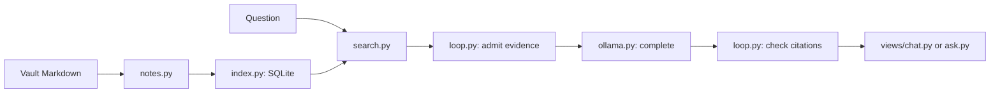

# Agent Brain

Read-only tools and chat for an Obsidian vault. Local Ollama powers hybrid search.

One SQLite cache serves the Streamlit app and shell commands, with Search chat as the
default. Experimental exploration reads additional passages and follows links; it can
also search again.

## Setup

You need [Ollama](https://ollama.com) and [uv](https://docs.astral.sh/uv/).

Run Ollama with cloud features disabled. For a foreground server in a separate terminal:

```bash
OLLAMA_NO_CLOUD=1 ollama serve
```

For the Ollama desktop app, set its local-only server setting and restart it as described
in the [Ollama FAQ](https://docs.ollama.com/faq). The client requires a loopback endpoint,
rejects advertised cloud models, and bypasses HTTP proxies and redirects; server
configuration still matters because the client cannot certify an arbitrary local proxy.

```bash
ollama pull nomic-embed-text   # 274 MB, for search
ollama pull qwen3:4b           # 2.5 GB, for answers
```

Then, from this folder:

```bash
uv sync --locked
uv run streamlit run app.py --server.address 127.0.0.1 --browser.gatherUsageStats false
```

The first launch reads your vault and builds the index; later launches check freshness and
re-embed changed notes. An older cache rebuilds derived rows once to remove ambiguous
embedding provenance and store source lines; a model change, including a digest change
under the same tag, also rebuilds the cache. Vault files remain untouched.

## Using it on another device

Clone this repo next to your vault and run the same two commands. Nothing else to configure.

```
~/Repos/
├── Obsidian_Vault/     your notes, synced by git
└── Agent_Brain/        this repo
```

The vault is found by looking for a folder containing `.obsidian`: first
`AGENT_BRAIN_VAULT` if you set it, then the folder you picked last time, then a single sibling
of this repo, then any parent of where you ran the command. If two vaults sit side by side it
asks rather than guessing, and remembers your answer.

An explicit invalid `AGENT_BRAIN_VAULT` stops resolution; correct that setting rather than
silently opening a different vault. Notes resolving outside the vault are rejected;
external file symlinks are excluded from ingestion.

The index is never committed. It lives in `~/.cache/agent_brain/`, one file per vault, because
it holds your note text and both repos have remotes. Each device builds its own in about a
minute.

`XDG_CACHE_HOME` can relocate the cache, whose resolved location must stay outside the vault.
Use one active refresh at a time, avoiding rebuilds while another app or CLI command
refreshes the same vault; SQLite's busy timeout is not a refresh scheduler.

## Shell commands

Point the commands at a vault containing `.obsidian`:

```bash
export AGENT_BRAIN_VAULT=/path/to/Obsidian_Vault
uv run python ask.py search "storage decision"
uv run python ask.py read "work/Thesis.md"
uv run python ask.py backlinks "work/Thesis.md"
uv run python ask.py related "work/Thesis.md"
uv run python ask.py survey
uv run python ask.py ask "Which storage engine did I choose?"
```

The five deterministic commands return passages or index facts without a chat model.
Search embeds the query; related needs current vectors.

Every command refreshes a stale index, which can require Ollama. A current cache supports
`read`, `backlinks`, and `survey` with Ollama stopped. `read` returns indexed passages
with headings, not the complete original Markdown file; meaningful short facts are retained
and long reads are truncated.

All commands accept `--embed`, repeated `--kind`, and `--since` / `--until` in `YYYY-MM-DD`.
Search and ask accept `--passages` from 3 to 15; ask also accepts `--model`, `--context`
(4096, 8192, 16384, or 32768), and paired `--prior-user` / `--prior-assistant` values.
Filtered CLI calls discard that text-only prior pair; its original scope is unknown.

Ask defaults to four chat calls, eight tool attempts, 800 generated tokens per call, and
a 120-second chat timeout. Override these with `--max-calls`, `--max-tools`, `--max-tokens`,
and `--timeout`; `--max-tokens` takes a positive integer. Execution and context limits
produce a labeled incomplete result.

Both chat modes use `[E1]` passage identifiers and exploration also uses `[I1]` computed
index identifiers; the output maps each identifier to retrieved evidence and marks cited items.
Unknown identifiers and completed replies without any citations fail validation.
A known identifier proves that evidence was retrieved;
inspect the passage to judge whether it supports the claim.

Passage sources show the relative note path and original 1-based line range, such as
`projects/Atlas.md:8-12`, plus the heading and exact admitted excerpt. Lines refer to the
indexed version of the note; later edits can move them. Refresh to read those edits.
The app's **Open note in Obsidian** link uses Obsidian's [native URI](https://help.obsidian.md/Extending+Obsidian/Obsidian+URI)
to open the exact note; line numbers remain visible beside the excerpt.

Stdout contains results; stderr contains progress and errors. Success, including an
explicit insufficient-evidence or limit result, exits 0; model/index failures exit 1;
invalid invocations exit 2. `uv run python ask.py --help` lists commands.

## What it does

**Chat.** Ask a question to get an answer alongside retrieved notes; every source shows its
path, source lines, heading, type and date, and whether words or meaning found it.
Search makes one model call, validates citations before displaying the completed reply,
and displays only passages admitted to the prompt. Enable **Explore notes
with tools (experimental)** to use the bounded loop. It keeps one good prior exchange for
reference resolution, retrieving supporting facts again; a vault or scope change clears
the prior pair. Error and incomplete responses never become prior.

**Browse.** Filter across every note, or pick a folder and read anything in it. Each note
shows what links to it, what it links out to, and which notes are closest to it that it does
**not** already link to. Those are the links worth making.

**Graph.** Centre on a note and see what sits around it, one to three hops out along your own
wikilinks. Notes with more than 25 links are not expanded through, because a map-of-content
note otherwise drags in half the vault.

**Explore.** Groups the vault into themes and names each one, using the vectors already in
the index and a single model call per group. Below that, three things worth your attention:
concepts you linked but never wrote, notes you started and left nearly empty, and notes with
no links at all.

## Narrowing the search

Frontmatter supplies note types and creation dates for the sidebar filters; Chat, themes,
and search-scope counts use those filters. Browse, Graph, sidebar totals, and Explore's
gap lists show the full vault.

Dates can be ISO timestamps such as `2026-01-24 10:47:20` or English dates such as
`Thursday 26th February 2026 13:38:57`; English months use a fixed table so parsing works
across machine locales. Use the date filter when a question requires a date range;
mentioning a month in free text searches its words.

Notes with no date are excluded once a range is set, because an undated note cannot honestly
be said to fall inside it.

## How it finds things

Each search merges word and meaning rankings. Default Chat runs one search per question;
the tool loop chooses searches and note-navigation steps within its execution limits.

Word matching uses SQLite's FTS5. It is what finds an exact string: a command, an error code,
a person's name, or a note title. Common words are dropped first, otherwise a note repeating
"what" four times outranks the note that answers you.

Meaning matching embeds the question and compares it against every passage. At this size that
is a few milliseconds of numpy, so there is no vector index to build or maintain. The same
vectors, averaged per note, drive the related-notes list and the theme clustering.

Merging uses rank rather than score. A BM25 score and a cosine similarity are not on the same
scale, and normalising one onto the other breaks whenever the distribution shifts. Rank needs
no calibration: a passage scores `1/(60 + rank)` in each list, so appearing in both beats
topping one.

Notes are split at their headings, and each piece carries its heading path. "use port 5432" is
ambiguous on its own, and the same text under `Postgres > Local setup` is not.
Merged sections keep their intervening headings. Passages retain contiguous original text;
headings inside fenced code do not become section boundaries.

## Settings

App models, scope, passages, and context are in the sidebar. The app lists local models
already installed in Ollama and prefers the stored embedding model to avoid unnecessary
rebuilds. Shell settings are independent of sidebar state.

Under **Settings**, choose the passage count, context window and **Generation tokens**.
The generation budget defaults to 800 and accepts integers 128 through 4096; it applies to
both fixed Search chat and the experimental loop. The rebuild button sits under the vault
summary it invalidates.

`OLLAMA_HOST` defaults to `http://localhost:11434`. `AGENT_BRAIN_CHAT_MODEL` defaults to
`qwen3:4b`; `AGENT_BRAIN_EMBED_MODEL` defaults to `nomic-embed-text`; for shell commands,
`--embed` overrides stored metadata, which overrides the environment default. Models with
a thinking capability use native thinking parsing; reasoning is retained for tool
continuations and excluded from displayed answers. Generated-token limits include it.

## Development

```bash
uv run --locked pytest
```

Offline tests cover indexing recovery and scoped tools. Native HTTP and CLI integration
tests use temporary loopback servers and Streamlit tests use its headless AppTest; no test
reads your vault or calls a live model. GitHub Actions runs the locked environment.

For live model evaluation, see [the synthetic fixture and grading guide](evals/README.md);
its 20 cases compare fixed Search against the tool loop on temporary data, recording
answers and admitted evidence. Literal fact matches are debugging proxies; support is
graded manually. Keep Search as the default until the loop earns promotion.

```
app.py            the Streamlit app
ask.py            shell commands and argument parsing
brain/locate.py   which folder is the vault, and where the index goes
brain/notes.py    reading markdown and frontmatter, splitting notes into passages
brain/index.py    the SQLite schema, building and refreshing
brain/search.py   hybrid retrieval and related note ranking
brain/links.py    backlinks, neighbourhoods, and what the vault is missing
brain/themes.py   clustering the notes and naming the groups
brain/answer.py   one-search answers using shared evidence and citation checks
brain/tools.py    scoped, read-only index tools
brain/loop.py     bounded execution with evidence admission and citation checks
brain/ollama.py   local HTTP transport, embeddings, and completed chat replies
views/            one module per tab, plus notelist.py shared by all of them
evals/            synthetic vault and case catalog, with a comparison runner
```

Runtime packages are Streamlit and PyYAML, with NumPy declared directly for vector math;
NumPy was already installed through Streamlit. HTTP and SQLite use the standard library,
with no agent framework or vector database required.

There is no Streamlit inside `brain/` and no SQL inside `views/`. That line is worth keeping:
it means the logic can be read and tested without the UI, and the UI can be changed without
touching the logic.

### Reading the code

Start with `brain/notes.py`: `read_note` reads metadata and `chunk_note` preserves passage
text and line ranges; `brain/index.py:refresh` stores those passages and embeddings in
SQLite. `brain/search.py:search` merges word and vector rankings.

`brain/answer.py:answer` performs one search and one chat call; the optional
`brain/loop.py:answer` lets the model call the five read-only functions in `brain/tools.py`.
Both use the same evidence admission and citation checks in `brain/loop.py`.
`brain/ollama.py:complete` sends the chat request and requires Ollama's completion flag.



The diagram shows fixed Search; for exploration, read the bounded loop after tracing that
flow. `app.py` and `ask.py` handle configuration and presentation; neither changes notes.

## Read only

Agent Brain never writes to your vault. It reads notes and answers questions, so it cannot
corrupt anything mid-sync on a device where git is pulling.

An edit during refresh leaves the cache stale and stops the caller instead of certifying
old text as current. Re-run after the edit finishes. Failed embedding batches remain
resumable; switching back to another model discards incompatible derived vectors.
